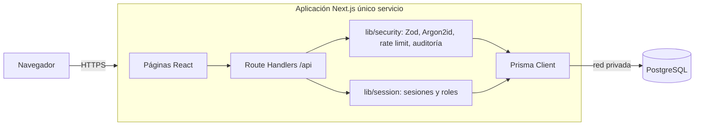
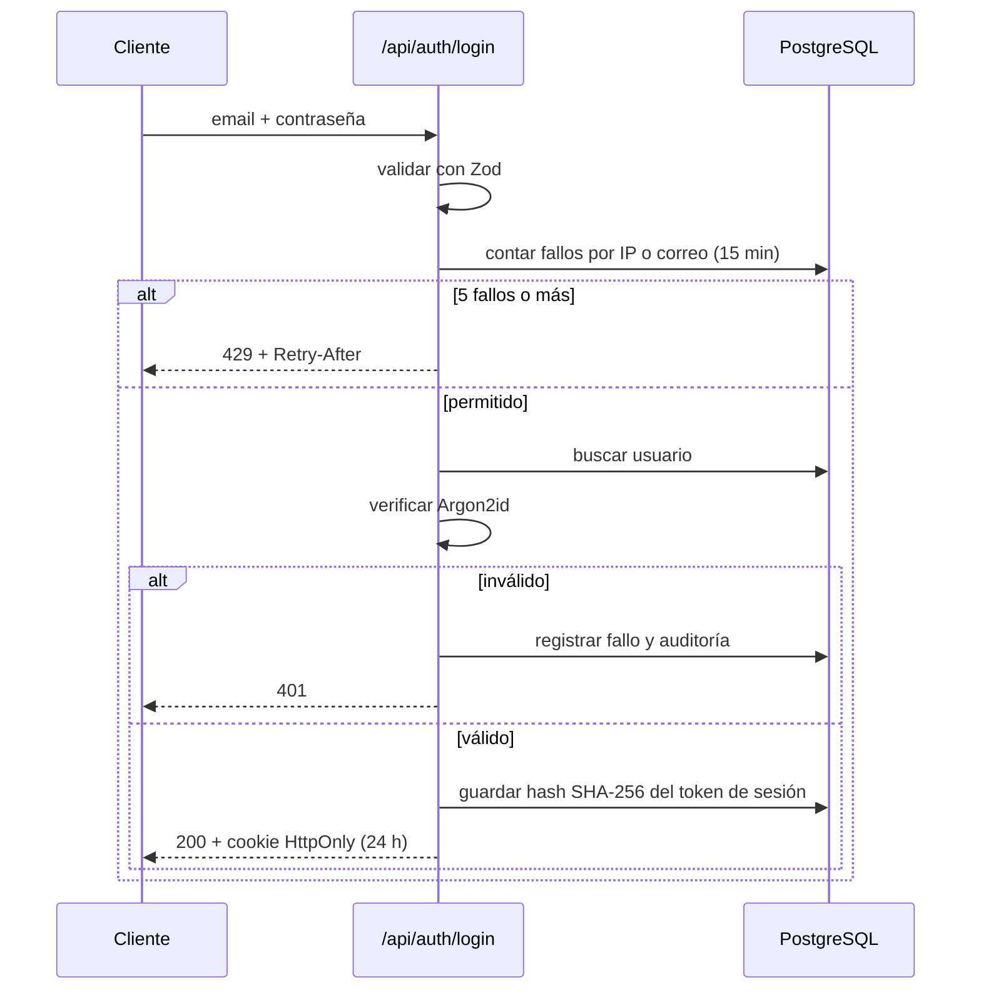

# Arquitectura — SecureTasks

## Diagrama de arquitectura

## Flujo de autenticación

## Roles

| Rol | Permisos |
|---|---|
| estudiante | CRUD de sus propias tareas |
| docente | Lo anterior + resumen de actividad de estudiantes |
| administrador | Todas las tareas, gestión de usuarios y roles, auditoría |

## Estructura

- `src/app/api/**`: API REST (Route Handlers)
- `src/app/*/page.tsx`: interfaz (login, registro, recuperación, dashboard)
- `src/lib/`: seguridad, sesiones, cliente Prisma
- `prisma/`: esquema y migración `20260101000000_init`
- `tests/`: pruebas automatizadas con Vitest
- `docs/`: documentación de seguridad
